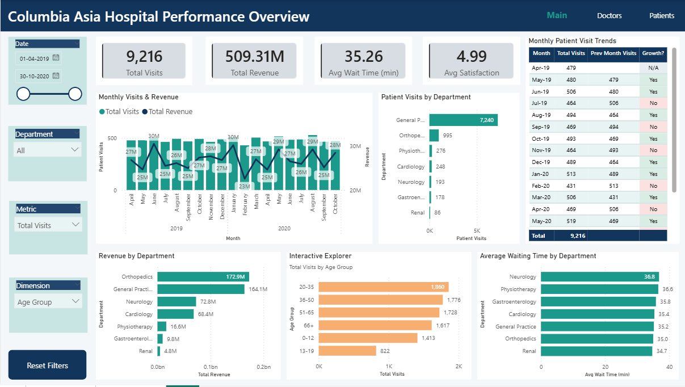
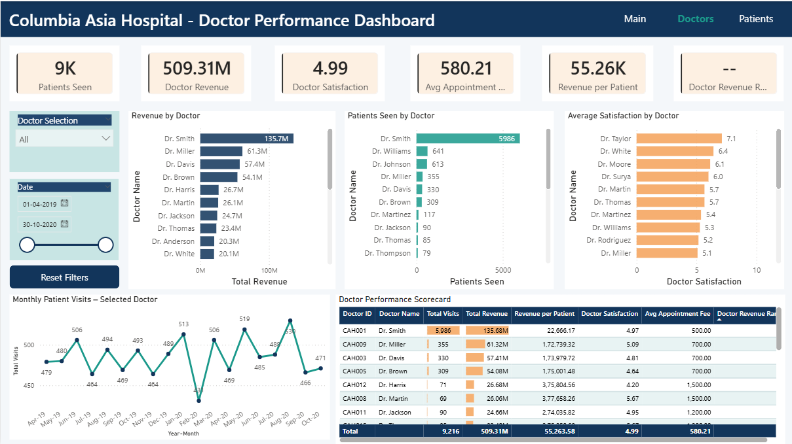
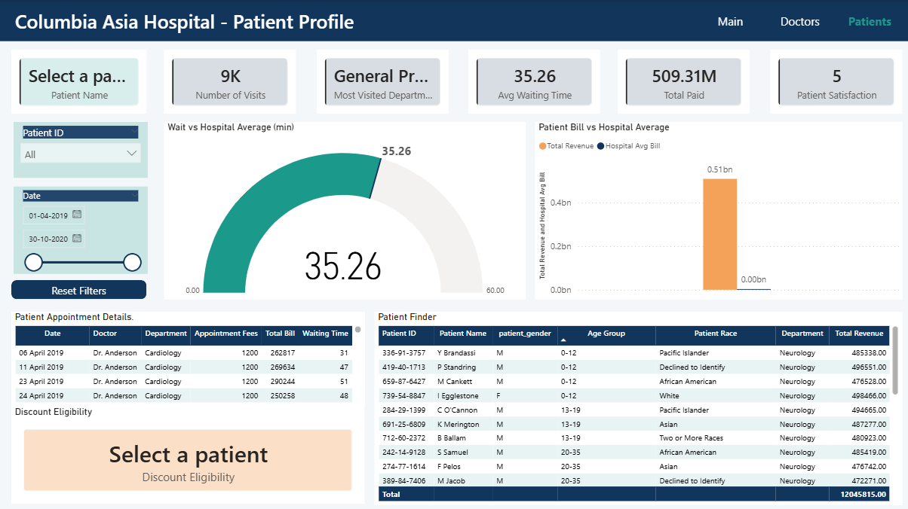

# Columbia Asia Hospital – Healthcare Analytics



An end-to-end data analytics project combining **Power BI, SQL, Power Query and Excel** to analyse hospital operations, patient demographics, doctor performance and revenue generation.

## Table of Contents

- [Project Overview](#project-overview)
- [Tools & Technologies](#tools--technologies)
- [Project Objectives](#project-objectives)
- [Data Preparation & Modelling](#data-preparation--modelling)
- [Power BI Dashboard](#power-bi-dashboard)
- [SQL Analysis](#sql-analysis)
- [Key Findings](#key-findings)
- [Project Limitations](#project-limitations)
- [Acknowledgements](#acknowledgements)

---

## Project Overview

This project analyses hospital patient, doctor and billing data covering April 2019 to October 2020. The objective is to identify operational trends, evaluate revenue performance and provide data-driven recommendations to improve hospital management.

**Project Highlights**

- 9,216 patient records analysed
- 22 doctors across 7 departments
- 19 months of hospital data
- 3 interactive Power BI dashboard pages
- 21 analytical project questions covering Power BI and SQL

## Tools & Technologies

| Tool | Purpose |
|---|---|
| Microsoft Power BI | Interactive dashboards and data visualisation |
| Power Query | Data cleaning and transformation |
| DAX | Measures and analytical calculations |
| MySQL | SQL queries and data analysis |
| Microsoft Excel | Initial data exploration and source data |

## Project Objectives

1. Analyse hospital revenue and department-wise performance.
2. Evaluate doctor workload and patient distribution.
3. Identify patient demographic and satisfaction trends.
4. Analyse waiting times and monthly visit patterns.
5. Develop data-driven recommendations for doctor hiring and patient discount strategies.

## Data Preparation & Modelling

- Imported and combined two Excel datasets using `patient_id`.
- Checked for duplicate records and missing values.
- Standardised column names, text values and data types.
- Created calculated columns including Age Group, Wait Band, Bill Band, Visit Date and Visit Hour.
- Designed a star-schema data model with one fact table and four dimension tables.
- Created DAX measures for KPIs and comparative analysis.

## Power BI Dashboard

The interactive report consists of three pages:

### 1. Main Dashboard
Provides an overview of hospital performance, including revenue, patient visits, waiting times and monthly trends.


### 2. Doctors Dashboard
Focuses on doctor-wise performance, revenue generation, patient distribution and satisfaction scores.



### 3. Patients Dashboard
Explores individual patient profiles, demographics, waiting times and discount eligibility.



**Interactive Features**
- Dynamic KPI cards and slicers
- Field parameters for metric and dimension selection
- Cross-filtering and interactive visualisations
- Page navigation and reset filters

## SQL Analysis

Used MySQL to solve analytical questions involving:

- Common Table Expressions (CTEs)
- Aggregate functions and conditional aggregation
- Window functions such as `LAG()` and ranking
- Revenue and patient analysis by doctor and department
- Male-to-female patient and billing ratios
- Patient satisfaction analysis
- Simpson's Diversity Index to evaluate patient diversity

The SQL scripts and queries are available in the `SQL` folder.

## Key Findings

| Metric | Finding |
|---|---|
| Total hospital revenue | 509.31M |
| Total patient records | 9,216 |
| Highest revenue department | Orthopedics |
| General Practice visits | 78.6% of all visits |
| Average waiting time | 35.26 minutes |
| Patients treated by Dr. Smith | 5,986 |
| Satisfaction response rate | 27.3% |

### Business Recommendations

- Prioritise hiring in General Practice and Orthopedics based on doctor workload and revenue contribution.
- Introduce rule-based patient discount strategies based on waiting times, bill amounts and age groups.
- Improve patient feedback collection to obtain more reliable satisfaction insights.
- Collect cost and repeat-visit data to enable profitability and patient retention analysis.

## Repository Structure

```text
Columbia-Asia-Hospital-Analytics/
│
├── Dashboard/
│   └── Columbia_Asia_Hospital.pbix
│
├── Screenshots/
│   ├── 01_Main_Dashboard.png
│   ├── 02_Doctors_Dashboard.png
│   └── 03_Patients_Dashboard.png
│
├── SQL/
│   └── SQL_Queries.sql
│
├── Documentation/
│   ├── Project_Presentation.pptx
│   └── Project_Report.docx
│
└── README.md
```

## Project Limitations

- Patient satisfaction scores were available for only 27.3% of records.
- Cost data was unavailable, so actual hospital profitability could not be calculated.
- Each patient appears once in the dataset, limiting repeat-visit analysis.

## Acknowledgements

Project completed as part of the Newton School Data Analytics programme. The hospital dataset was provided through the programme.

---

**Author:** Deepika Raj

**Technologies:** Power BI | SQL | DAX | Power Query | Excel
